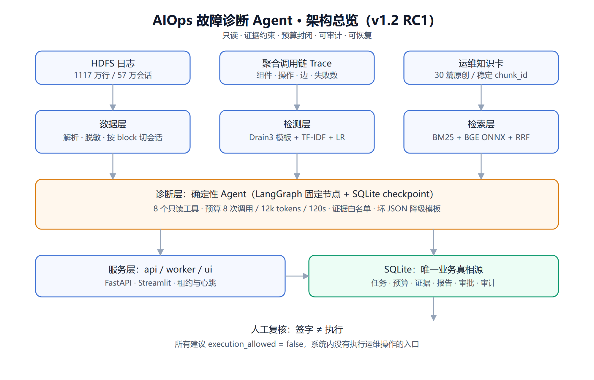

# AIOps Fault Diagnosis Agent

[](https://github.com/q2392044156/aiops-fault-diagnosis-agent/actions/workflows/ci.yml)
[](LICENSE)

面向 HDFS 日志与调用链的故障诊断研究原型。它不追求"让大模型自动修机器"，而是回答一个更实际的问题：**当系统异常时，如何把海量日志压缩成可核查的事件，再结合冻结版本的运维知识，给出带证据、可追溯、可人工复核的诊断报告。**

系统遵守两条硬边界：

1. 只给异常线索、证据引用和只读排查建议，**不执行**重启、删除、切流、写库；所有建议固定 `execution_allowed=false`。
2. 没有合格真实根因标签时，不把公开故障注入标签包装成生产根因，也不虚报 Top-1 与 MTTD。

当前版本 **v1.2 RC1**（`1.2.0rc1`），含路线 A 真实故障实验。

---

## 最新结果

| 实验台 | 样本 | Top-1 | Top-3 | Top-5 | 冻结测试集 |
| --- | --- | --- | --- | --- | --- |
| WSL 单机（Hadoop 3.3.6） | 68（38 卷 + 10 心跳 + 20 安全模式） | **98.5%**（CI [0.9213, 0.9974]） | 100% | 100% | n=14，100% |
| Docker Compose（1NN+3DN） | 81（28 卷 + 27 心跳 + 26 安全模式） | **93.8%**（CI [0.8635, 0.9733]） | 93.8% | 93.8% | n=30，93.3% |

Docker 81 例失败归因：**命中 76、证据缺失 5、召回缺失 0、排序错误 0**——心跳与安全模式全对，剩余 5 例缺证据。

### 证据选择 P2/P3 评测

P2 加入 **组件关注、信号/严重度/模板稀有度/时间评分、结构化质量**；P3 加入 **模板签名去重、堆栈折叠、token 预算**。

| 预算 | Docker token | Docker 召回 | Docker 精度 | Docker 充分 | WSL token | WSL 召回 | WSL 精度 | WSL 充分 |
| --- | --- | --- | --- | --- | --- | --- | --- | --- |
| 10 行 | 354 | 0.529 | 0.445 | 60/81 | 321 | 0.552 | 0.312 | 67/68 |
| 30 行 | 834 | 0.690 | 0.201 | 60/81 | 884 | 0.825 | 0.165 | 67/68 |
| 50 行 | 1,077 | 0.698 | 0.145 | 60/81 | 1,136 | 1.000 | 0.128 | 67/68 |
| 全量 | 2,221 | 0.699 | 0.067 | 60/81 | 2,671 | 1.000 | 0.053 | 67/68 |

关键变化：

- 50 行证据包 token 约 **1,077/1,136**，比全量少一个数量级；
- Docker 召回在 30 行后基本饱和（0.690→0.698），WSL 50 行达到 1.000；
- Docker 仍有 21/81 例选不出信号或 ERROR，证据充分率 74.1%；
- 50 行精度约 0.15/0.13，说明上下文行仍多，但这是为了保留排查线索的取舍；
- 21 例清单见 `resources/evaluation/lab/evidence_gaps_docker.json`，补采范围为 `fault_start-60s` 到 `cutoff+60s` 的 NN/DN 日志。

P2/P3 选择器输出结构化质量：components、levels、template_diversity、time_range、tokens_est、sufficient；focus_component 优先保留故障组件，模板稀有度和时间近因作为加分项。

### Phase 0 证据补采

Docker DN_VOLUME 的 21 例注入没有产生 No space left / failed volume 信号，属于 invalid injection，已从证据评测中隔离；用 WSL 卷故障重放 21 例替代。

| 项 | 结果 |
| --- | --- |
| 隔离 Docker 例 | 21 |
| 重放 WSL 卷故障 | 21 |
| 证据充分 | 21/21 |
| 50 行证据召回 | 1.000 |
| 病例 Top-1 | 21/21 |

替换清单：resources/evaluation/lab/recaptured_manifest.json。21 例已合并为 v2 数据集：Docker 有效 60 例 + WSL 原始 68 例 + WSL 补采 21 例 = 149 例。

### v2 合并结果

| 数据 | 案例 | 事件 | 事件 Top-1 | 案例 Top-1 |
| --- | --- | --- | --- | --- |
| Docker 有效 | 60 | 232 | 218/232 = 94.0% | 60/60 |
| WSL 原始 | 68 | 196 | 189/196 = 96.4% | 67/68 |
| WSL 补采 | 21 | 38 | 38/38 = 100% | 21/21 |
| **合计** | **149** | **466** | **445/466 = 95.5%** | **148/149 = 99.33%** |

引用覆盖 gold：**583/667 = 87.4%**；引用精度 10.1%。检测 FPR 仍为 Docker 0/166、WSL 0/74。

v2 冻结切分：test 30 / train 119，test 含 Docker 3、WSL 27，hash 见 resources/evaluation/lab/v2_split.json。

LangGraph 在补采 21 例上的对照：native 38/38 事件、21/21 案例；LangGraph 31/38 事件、15/21 案例。存在 parity 回归，暂不能宣称双后端一致，全量 v2 LangGraph 待修复后重跑。

### 引用覆盖率

| 指标 | Docker | WSL |
| --- | --- | --- |
| 引用覆盖 gold | **68.3%**（377/552） | **86.9%**（258/297） |
| 引用精度 | 9.6% | 12.3% |
| 被引用日志行 | 3,910 | 2,096 |

Docker 引用覆盖率低，主要因为报告只引用部分证据行，且大量 gold 是启动期卷相关行，不是最终支撑候选的少量证据。

### A→B 联合指标

检测门禁使用冻结的 severity-first novelty_sliding_v4，窗口统一为 **60 秒 / 10 秒步长 / 每组件 / 最多 500 行**。Docker 正常窗口 553 个（测试 166），WSL 244 个（测试 74）。规则是：**ERROR/FATAL 直接 PASS（已审核的良性错误白名单除外）；WARN 仅当新模板或频次超正常基线时 PASS；INFO 用新颖度兜底，阈值 0.10。**

| 指标 | Docker | WSL |
| --- | --- | --- |
| 检测 FPR | **0.0%**（0/166，CI [0, 0.0226]） | **0.0%**（0/74，CI [0, 0.0494]） |
| 检测 Recall | 窗口 275/294；案例 80/81（98.8%） | 窗口 212/212；案例 68/68 |
| 事件数 | 275 | 196 |
| 事件 Top-1 | **90.5%**（249/275） | **96.4%**（189/196） |
| 案例 Any-Event Top-1 | **97.5%**（79/81） | **98.5%**（67/68） |
| 端到端 Top-1 | **97.5%**（79/81） | **98.5%**（67/68） |

每个 PASS 窗口独立创建一个 event，并独立跑一次诊断；一个案例只要任意 event 命中，就算案例命中。全量 149 例中门禁 PASS 148 例（Docker 80/81、WSL 68/68），合计案例级端到端 **146/149 = 97.99%**。  
说明：Docker 有 1 例卷故障无窗口通过；该例原本也未命中根因，所以端到端不额外下降。

六项工程能力（每项都有代码、单测与数字）：

| 能力 | 关键结果 |
| --- | --- |
| P0-1 工具路由 | 规则 93.3% > 受控 90.0% > 自由 66.7%；受控参数 100% 结构化 |
| P0-2 轨迹评测 | 30 例封存：18 clean + 12 abstained，0 重试、0 越权引用 |
| P0-3 上下文工程 | 压缩省 36.5% token，Schema/引用/双类证据持平 |
| P1-4 可观测性 | 单次诊断 29 个 span，6.73s 中 6.59s 在生成 |
| P1-5 红队 | 40/40 拦截（100%），0/10 误杀 |
| P2-6 MCP | 4 个只读工具，initialize/list/call 冒烟通过 |

> 知识库：30 → **104 张**（新增 74 张：50 张 Apache 3.3.5 文档摘要 + 24 张源码/配置证据卡）；平均 406 字，50 张带根因码，覆盖 10/11 个根因码。

> 两套实验数字**不能相加**：注入形态、拓扑、样本量都不同。

---

## 两种执行后端：主引擎与 LangGraph

同一套业务表、同一批 incident，提供两种编排方式：

| 维度 | 主引擎（默认） | LangGraph 后端 |
| --- | --- | --- |
| 入口 | `diagnosis/engine.py` | `diagnosis/framework/graph.py` + `query_v11/engine.py` |
| 编排 | 自研 7 节点状态机 | `StateGraph` + 条件路由 |
| 状态 | SQLite 业务表 | 业务表 + checkpoint |
| 开关 | 无需配置 | `agent_backend: framework_candidate` + `execution_backend: langgraph` |
| 用途 | 路线 A 主结果 | 框架对照、面试演示 |

### 主引擎：实现过程

1. **取证**：`query_logs` 拉全量窗口，`select_log_rows` 按“信号行 → ERROR/WARN → 窗口尾部”保留 50 行；
2. **信号码**：`detected_codes_from_text` 按出现次数排序，卷故障与心跳并存时卷优先（上游因）；
3. **检索**：把信号码传给 `retrieve_runbook(..., code=...)`，检索池收窄到对应根因卡；
4. **排序**：`rank_root_causes` 先按强信号，再按弱先验（volume/disk/heartbeat），最后看证据；
5. **报告**：证据白名单 + Pydantic 校验；失败或引用越权走模板降级。

运行：

```powershell
python ops/lab/harness/ingest.py --case <case_dir> --database runtime/lab/wsl.sqlite3
python ops/scripts/evaluate_incidents.py --database runtime/lab/wsl.sqlite3 --cases ops/lab/wsl_cases
```

### LangGraph：实现过程

1. **建图**：7 个业务节点映射为图节点，`START` 按持久化 `current_node` 条件路由；
2. **单步推进**：每次 `graph.invoke` 只执行一个节点，然后 `END`；遇到 `AgentYield` 写回让出节点；
3. **checkpoint**：`DatabaseCheckpointSaver` 写 SQLite，thread 为 `<release>:<diagnosis>:<revision>`；
4. **对齐检索**：候选路径复用 `detected_codes_from_text`，并把 code 传入 `retrieve_runbook`，补齐信号码硬过滤；
5. **业务表仍是真相源**：图只保存最小进度，预算/工具/审批都在 SQLite。

运行：

```powershell
# 单例
python ops/lab/harness/ingest.py --case <case_dir> --database runtime/lab/lg_wsl.sqlite3 --agent-backend langgraph

# 5 例 PoC
python ops/lab/harness/langgraph_poc.py

# 服务方式
python -m aiops_diag.platform serve --config resources/configs/service_v12_rc1.yaml
```

全量重放的做法：复制案例与数据库 → 清空旧报告 → 逐例带 `--agent-backend langgraph` 重放 → 用同一评测脚本评分；结果文件见 [P2-8 报告](documentation/P2-8_LangGraph全量对比.md)。

### 两种方式的结果对比

| 指标 | WSL 主引擎 | WSL LangGraph | Docker 主引擎 | Docker LangGraph |
| --- | --- | --- | --- | --- |
| Top-1 | **98.5%**（67/68） | **98.5%**（67/68） | **93.8%**（76/81） | **93.8%**（76/81） |
| Top-3 | 100% | 100% | 93.8% | 93.8% |
| Top-5 | 100% | 100% | 93.8% | 93.8% |
| MRR | 0.9926 | 0.9926 | 0.9383 | 0.9383 |
| 冻结测试集 | n=14，100% | n=14，100% | n=30，93.3% | n=30，90.0% |
| checkpoint | — | 1224 条 | — | 1458 条 |

说明：

- Docker LangGraph 最初只有 75.3%（心跳 14/27），补齐信号码硬过滤后到 91.4%（心跳 27/27）；
- 两套引擎使用**独立数据库**，不能把结果混在一起算平均；
- 图编排不改变指标，真正决定指标的是证据选择与检索策略。

---

## 系统如何工作



```text
HDFS 日志
          ↓
数据校验、脱敏、稳定分组切分
          ↓
冻结 Drain3 + TF-IDF/LR 异常检测
          ↓
确定性查询构建 ──→ BM25 + BGE ONNX + RRF 知识检索
          ↓                         ↓
只读日志工具          固定版本知识证据
          └──────────┬──────────────┘
                     ↓
         确定性 Agent 状态机 + SQLite 状态
                     ↓
         结构化报告 / 安全模板降级
                     ↓
              人工复核与审计留痕
```

Agent 节点固定：`RECEIVED → VALIDATED → DETECTED → EVIDENCE_COLLECTED → RETRIEVED → HYPOTHESES_RANKED → REPORT_VALIDATED`。预算：8 次工具调用、3 次 LLM 调用、12k token、120s、最多 2 次修订。

三个服务：

- `api`：接收批次、创建诊断、查询事件/报告/工具调用、处理人工审批；
- `worker`：执行检测、检索、Agent 工作流与报告生成；
- `ui`：Streamlit 复核台。

SQLite 是任务、预算、工具缓存、报告、审批与审计的业务真相源；checkpoint 只保存流程恢复需要的图状态。

底层模型基线（冻结）：

| 组件 | 指标 |
| --- | --- |
| 异常检测（TF-IDF + LR） | F1 0.883181、AP 0.789731、FPR 0.006374 |
| 门禁检测（severity-first novelty_sliding_v4） | 60s/10s 滑动窗口；Docker FPR 0/166、WSL 0/74；事件 275/196 |
| 知识检索（Hybrid Top-3） | Recall 0.975、MRR 0.9375、nDCG 0.7827 |

完整分层与四条不变量见 [ARCHITECTURE.md](documentation/ARCHITECTURE.md)。

---

## 快速开始（Demo，约 5 分钟，无需 API Key）

仓库内置离线端到端演示：一条 HDFS 日志 → 异常会话 → 事件 → 受控诊断 → 带引用的报告 → 人工复核，全程约 1 秒。

```powershell
conda activate aiops-fault-diagnosis-agent
python demo/run_demo.py            # 离线，不花钱
python demo/run_demo.py --online   # 在线，单次约 ¥0.03（需 DEEPSEEK_API_KEY）
```

预期看到：`diagnosis_status`、`final_status=APPROVED_REPORT`、工具调用次数与报告引用。

- 3 分钟演示脚本：[demo/README.md](demo/README.md)
- 全量测试与结构校验：

```powershell
python -m pytest -q --basetemp=.pytest-tmp
python ops/scripts/validate_project_structure.py
```

> Windows 上若默认临时目录不可写，保留 `--basetemp=.pytest-tmp`。

---

## 完整复现

### 1. 安装

要求 Python 3.11（`>=3.11,<3.12`）、Conda（推荐）、Docker（仅容器实验需要）。

```powershell
conda env create --file environment.yml
conda run --name aiops-fault-diagnosis-agent python -m pip install -r requirements-framework-lock.txt
conda run --name aiops-fault-diagnosis-agent python -m pip install -e ".[dev,research,framework]" --no-deps
conda run --name aiops-fault-diagnosis-agent python -m pip check
```

### 2. 测试与校验

```powershell
conda run --name aiops-fault-diagnosis-agent python -m pytest -q --basetemp=.pytest-tmp
conda run --name aiops-fault-diagnosis-agent python ops/scripts/validate_project_structure.py
```

### 3. 路线 A：WSL 单机（推荐，故障更真实）

依赖 WSL2 + Ubuntu + JDK 11 + Hadoop 3.3.6，数据目录是 64MB ext4 loop 镜像。

```bash
bash ops/lab/wsl/readonly_volume.sh
python ops/lab/wsl/run_case.py --fault DN_VOLUME --database runtime/lab/wsl.sqlite3
python ops/lab/wsl/run_case.py --fault DN_HEARTBEAT --database runtime/lab/wsl.sqlite3
python ops/lab/wsl/run_case.py --fault NN_SAFE_MODE --database runtime/lab/wsl.sqlite3
python ops/scripts/evaluate_incidents.py --database runtime/lab/wsl.sqlite3 --cases ops/lab/wsl_cases
```

说明与安装步骤见 [ops/lab/wsl/README.md](ops/lab/wsl/README.md)。

### 4. 路线 A：Docker Compose（规模化，环境受限）

```powershell
docker compose -f ops/lab/compose.yaml up -d
python ops/lab/harness/run_batch.py --real --per-fault 7 --observe 12 --database runtime/lab/real_batch.sqlite3
python ops/scripts/evaluate_incidents.py --database runtime/lab/real_batch.sqlite3 --cases ops/lab/real_batch_cases
docker compose -f ops/lab/compose.yaml down -v
```

### 5. 评测、红队与 MCP

```powershell
python ops/scripts/evaluate_router.py
python ops/scripts/evaluate_trajectory.py --database runtime/v12/service.sqlite3
python ops/scripts/evaluate_context.py --database runtime/v12/service.sqlite3
python ops/scripts/run_redteam.py
python ops/scripts/attribute_failures.py --database runtime/lab/real_batch.sqlite3 --cases ops/lab/real_batch_cases --output resources/evaluation/lab/failure_attribution
python ops/scripts/mcp_smoke.py
```

路由与上下文消融需要 `DEEPSEEK_API_KEY`；其余可离线运行。

### 6. 数据与制品

`data/`、`artifacts/`、`experiments/`、`runtime/`、`ops/lab/*_cases/` 均不提交 Git，需在本地生成。密钥只放在 `.env`（已忽略），示例见 [.env.example](.env.example)。

---

## 目录结构

```text
aiops-fault-diagnosis-agent/
├─ src/
│  ├─ offline/       # 离线数据流程一级入口
│  │  ├─ capture/    # 故障注入、正常采集、证据落盘
│  │  ├─ ingestion/  # 多格式 adapter、规范化、滑动窗口
│  │  ├─ detection/  # 按来源模板、severity-first 门禁
│  │  └─ evaluation/ # FPR/Recall、事件、证据、引用评测
│  ├─ online/        # 在线诊断流程一级入口
│  │  ├─ diagnosis/  # 7 节点诊断、结构化证据选择
│  │  ├─ knowledge/  # 104 卡 RAG
│  │  └─ reporting/  # 严格 JSON 报告 Schema
│  └─ aiops_diag/    # 共享基础设施 + 旧导入兼容 shim
│     ├─ data/       # 接入、脱敏、审计与标准化
│     ├─ detection/  # LR/LSTM 检测
│     ├─ knowledge/  # BM25/BGE/RRF 检索与报告生成
│     ├─ diagnosis/  # Agent、路由、工具与编排
│     ├─ evaluation/ # 轨迹、路由、红队评测
│     ├─ platform/   # FastAPI、worker、SQLite、Streamlit、MCP
│     └─ release/    # 发布冻结与导出
├─ resources/        # 配置、知识卡、评测结果
├─ ops/              # 实验台、脚本与红队用例
├─ documentation/    # 报告、架构与验收记录
├─ tests/            # 自动化测试
├─ demo/             # 离线端到端演示
├─ Makefile
├─ LICENSE
└─ pyproject.toml
```

依赖方向与模块边界见 [PROJECT_STRUCTURE.md](PROJECT_STRUCTURE.md)，每个源码目录有独立 `README.md`。

---

## 文档索引

| 内容 | 路径 |
| --- | --- |
| 一页版路线 A 最终报告 | [documentation/路线A_最终报告.md](documentation/路线A_最终报告.md) |
| WSL / Docker 对比 | [documentation/路线A_WSL与Docker对比.md](documentation/路线A_WSL与Docker对比.md) |
| 失败归因 | [resources/evaluation/lab/failure_attribution.md](resources/evaluation/lab/failure_attribution.md) |
| WSL 指标 | [resources/evaluation/lab/wsl.md](resources/evaluation/lab/wsl.md) |
| Docker 指标 | [resources/evaluation/lab/real_batch.md](resources/evaluation/lab/real_batch.md) |
| 工具路由 | [documentation/P0-1_工具路由.md](documentation/P0-1_工具路由.md) |
| 轨迹评测 | [documentation/P0-2_轨迹评测.md](documentation/P0-2_轨迹评测.md) |
| 上下文工程 | [documentation/P0-3_上下文工程.md](documentation/P0-3_上下文工程.md) |
| 可观测性 | [documentation/P1-4_可观测性.md](documentation/P1-4_可观测性.md) |
| 红队 | [documentation/P1-5_红队评测.md](documentation/P1-5_红队评测.md) |
| MCP | [documentation/P2-6_MCP服务.md](documentation/P2-6_MCP服务.md) |
| 架构 | [documentation/ARCHITECTURE.md](documentation/ARCHITECTURE.md) |

---

## 边界与已知限制

- **真实数据仍偏窄**：只有 3 个根因码、实验室注入，不是生产工单；
- **Docker 指标仍有提升空间**：Top-1 93.8%，剩余 5 例证据缺失；
- **WSL 98.5% 有天花板效应**：单机、单形态、测试集 14 例；
- **MTTD 不可用**：Docker 含观测窗，WSL 未落库；
- **未覆盖**：真实 ENOSPC、IO error、网络分区、HA、NameNode 不可用、多故障叠加；
- **不是独立盲测**：同一脚本、同一机器生成。

这些问题在 [路线A_最终报告.md](documentation/路线A_最终报告.md) 中有完整说明。

---

## License

MIT，见 [LICENSE](LICENSE)。
