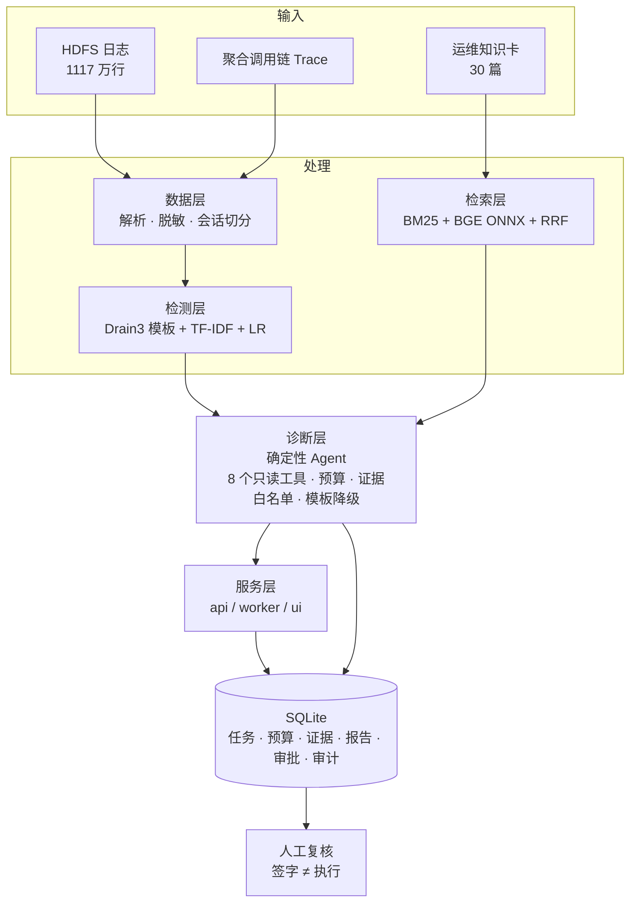

# 架构总览（一页纸）

> 这张图回答三个问题：数据从哪来、经过了谁、为什么不会乱来。
> 配套可运行版本：`python demo/run_demo.py`（离线，约 1 秒）。

## 分层



> GitHub 支持 Mermaid；同目录的 `architecture.svg` 可直接插进 PPT。

## 七个模块

| 模块 | 负责什么 | 不负责什么 |
| --- | --- | --- |
| `data` | 下载校验、逐行解析、脱敏、按 block 切会话、时间切分 | 不做检测，不做诊断 |
| `detection` | Drain3 模板、TF-IDF/LR、LSTM 对照、阈值与指标 | 不接触知识库 |
| `knowledge` | 知识卡切分、BM25 + BGE 检索、RRF 融合、证据门禁 | 不调用大模型 |
| `diagnosis` | 只读工具、预算、审批、状态机、LangGraph 编排 | 不写数据库事务（交给 platform） |
| `platform` | FastAPI、worker、SQLite、Streamlit、运行时装配 | 不实现算法 |
| `evaluation` | legacy / framework 离线对照 | 不参与在线请求 |
| `release` | 发布清单、哈希校验、导出 | 不改业务状态 |

依赖方向是单向的：`data → detection → diagnosis → platform`，`knowledge` 只被诊断层读取，`release` 读取各层产物。禁止反向导入。

## 四条不变量

1. **只读**：所有 `ActionAdvice.execution_allowed` 恒为 `false`，代码里没有执行运维操作的入口。
2. **证据约束**：报告只能引用本次检索返回的 `evidence_id`；越权引用直接判失败，最多修复一次后降级模板。
3. **预算封闭**：单次诊断最多 8 次工具、3 次模型调用、12,000 tokens、120 秒；调用前预扣、结束结算、崩溃保守清算。
4. **单一真相源**：`SQLite` 保存任务、预算、证据、报告、审批与审计；LangGraph checkpoint 只存流程指针，不保存原始日志或标签。

## 一次请求的路径

```text
POST /api/v1/batches/uploads
  → 校验幂等键与大小 → 落盘 → 创建 task（QUEUED）
  → worker 领取租约（30s，5s 心跳）→ 解析/打分/聚合
  → 写 batches/artifacts + SQLite（COMPLETED）
POST /api/v1/diagnoses
  → 创建 agent_run（预算快照）→ worker 领取
  → detect → query_logs → retrieve_runbook → rank → generate → approval
  → 报告落库（WAITING_REVIEW）→ 人工审批（APPROVED_REPORT）
```

## 想深入看哪里

- 目录与依赖约定：`PROJECT_STRUCTURE.md`
- 版本演进与指标：`documentation/v1.2_RC1_实施报告.md`
- 真实故障数据协议：`resources/evaluation/v1.2/real_incident_protocol/README.md`
- 每个模块的职责：各目录下的 `README.md`
